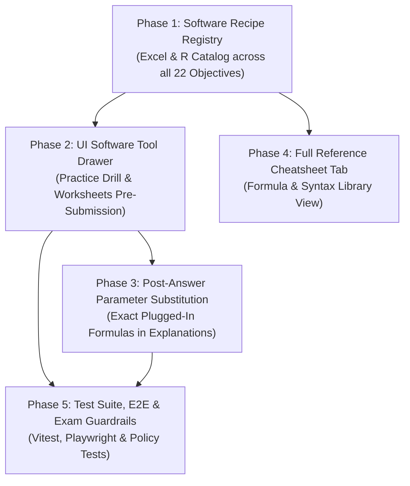

# Software Tooling Implementation Plan: Excel & R (RStudio) Integration

This document defines the phased implementation plan for embedding relevant **Microsoft Excel** functions/formulae and **R / RStudio** code into the practice drill, worksheets, and reference library.

---

## 1. Executive Summary & Pedagogical Goals

### The Problem
Quantitative methods courses in business and data analytics require students to master both:
1. **Conceptual mathematical foundations** (e.g. random variables, probability rules, sampling distributions, hypothesis testing logic, degrees of freedom, ANOVA partitions).
2. **Computational execution in standard tools** (Microsoft Excel in business contexts and R / RStudio in statistical computing and data science).

Students often encounter friction not in understanding statistical principles, but in memorizing divergent software syntax (e.g. Excel's `NORM.DIST(..., TRUE)` vs. R's `pnorm(..., lower.tail = TRUE)`, or `=T.DIST.2T` requiring positive $|t|$ vs. R's `2 * pt(-abs(t), df)`).

### The Solution: "Brain Power & Elbow Grease" Dual-Mode Tooling
* **During Active Problem Solving (Pre-Submission)**:
  - The software drawer reveals **generic canonical syntax** with documented argument roles (e.g. `=BINOM.DIST(number_s, trials, prob_s, cumulative)` and `dbinom(x, size, prob)` / `pbinom(q, size, prob)`).
  - The software *never* gives away the numerical answer or plugs in the numbers automatically before submission.
  - The learner must extract the problem variables ($n, p, k, \mu, \sigma, df$), determine directionality (point vs. cumulative vs. upper tail), execute in Excel or RStudio, and input the result.
* **After Submission (Post-Submission Debrief & Recap)**:
  - The mathematical explanation banner displays the **exact substituted formula** with problem parameters plugged in for instant verification.
* **In Timed Assessments (Exam Mode)**:
  - Aid is withheld during active testing; revealed in the post-exam score report.

---

## 2. Architecture & Design Principles

1. **Zero Schema Migrations on Existing Bank**:
   - The question bank comprises 137 approved templates. Rather than altering 137 JSON schemas, a centralized **Software Recipe Registry** (`web/src/features/reference/softwareRecipes.ts`) maps recipes by `module_id`, `family_id`, and `evidence_concept_ids`.
   - 100% of existing questions receive immediate tool coverage without breaking schema validation or approval provenance.
2. **Offline-First & Local**:
   - Pure client-side TypeScript data structures; zero external network requests or CDN dependencies.
3. **Keyboard & Accessibility First**:
   - Toggleable via hotkey (<kbd>u</kbd> for "Tools / Utilities" or <kbd>s</kbd> for "Software").
   - Accessible ARIA tabs for switching between Excel and R.
   - Screen-reader text alternatives and single-click copy buttons.

---

## 3. Phased Implementation Roadmap



---

### Phase 1: Canonical Software Recipe Catalog
**Goal**: Build a strongly typed, exhaustive registry of statistical recipes covering all 6 modules and 22 learning objectives.

#### 1.1 Data Schema
```typescript
export interface SoftwareRecipe {
  id: string;
  familyId?: string;
  moduleId: string;
  title: string;
  statisticalTask: string;
  
  // Excel specifications
  excel: {
    functionName: string;
    genericSyntax: string;
    argumentDescriptions: { name: string; description: string }[];
    notes?: string;
    commonPitfalls?: string;
  };

  // R (RStudio) specifications
  r: {
    functionName: string;
    genericSyntax: string;
    argumentDescriptions: { name: string; description: string }[];
    notes?: string;
    commonPitfalls?: string;
  };
}
```

#### 1.2 Module Recipe Coverage Matrix
* **Module 1 (Probability Foundations & Discrete Distributions)**:
  - Basic probability (complement, union, conditional, Bayes): Helper arithmetic & contingency tables.
  - Binomial Distribution: `=BINOM.DIST` (PMF vs CDF) & `dbinom` / `pbinom`.
  - Poisson Distribution: `=POISSON.DIST` (exact vs cumulative) & `dpois` / `ppois`.
  - Discrete RVs: `=SUMPRODUCT` for $E[X]$, second moment $E[X^2]$, variance & `weighted.mean()`, `sum(x * p)`.
  - Linear Combinations: Scaling and independent sums.
* **Module 2 (Descriptive Statistics & Exploratory Data Analysis)**:
  - Measures of Center: `=AVERAGE`, `=MEDIAN`, `=MODE.SNGL` & `mean()`, `median()`.
  - Dispersion: `=VAR.S` vs `=VAR.P`, `=STDEV.S` vs `=STDEV.P` & `var()`, `sd()`.
  - Standardization: `=STANDARDIZE` & `scale()`.
  - Quartiles & IQR: `=QUARTILE.INC` vs `=QUARTILE.EXC` & `quantile(type = 7)`.
* **Module 3 (Continuous Distributions)**:
  - Standard Normal ($Z$): `=NORM.S.DIST`, `=NORM.S.INV` & `pnorm()`, `qnorm()`.
  - General Normal ($X$): `=NORM.DIST`, `=NORM.INV` & `pnorm(mean, sd)`, `qnorm(mean, sd)`.
  - Uniform: Interval probabilities and inverse cutoffs (`punif()`, `qunif()`).
  - Exponential: `=EXPON.DIST` & `pexp(rate)`, `qexp(rate)`.
* **Module 4 (Sampling Distributions & Confidence Intervals)**:
  - Standard Error of the Mean: `=STDEV.S / SQRT(n)` & `sd / sqrt(n)`.
  - Margin of Error & CI for Mean ($Z$): `=CONFIDENCE.NORM` & manual margin computation.
  - Margin of Error & CI for Mean ($t$): `=CONFIDENCE.T`, `=T.INV.2T` & `qt(1 - alpha/2, df)`.
  - Sample Size Planning: `=ROUNDUP` with square formulas & `ceiling()`.
* **Module 5 (Hypothesis Testing)**:
  - One-sample $Z$-test (two-tailed, left-tailed, right-tailed $p$-values): `=NORM.S.DIST` & `pnorm()`.
  - One-sample $t$-test (right, left, two-tailed): `=T.DIST.RT`, `=T.DIST(..., TRUE)`, `=T.DIST.2T` & `pt()`.
  - Two-sample pooled $t$-test: `=T.TEST(..., 2, 2)` & `t.test(var.equal = TRUE)`.
  - Two-sample paired $t$-test: `=T.TEST(..., 2, 1)` & `t.test(paired = TRUE)`.
  - Two-proportion pooled test: Pooled standard error arithmetic & `prop.test()`.
* **Module 6 (Regression Analysis & Inference)**:
  - Bivariate Regression: `=SLOPE`, `=INTERCEPT`, `=RSQ`, `=FORECAST.LINEAR` & `lm(y ~ x)`.
  - Regression Output ANOVA: `=F.DIST.RT` for Significance $F$, `=T.DIST.2T` for slope $p$-value & `summary(lm())`.
  - Multiple Regression: `=LINEST` array formula & `lm(y ~ x1 + x2 + ...)`.
  - Slope Confidence Interval: `=b1 +/- T.INV.2T(alpha, df) * sb1` & `confint(model)`.

---

### Phase 2: Interactive Software Tool Drawer UI
**Goal**: Integrate the generic syntax drawer into the active practice drill and worksheet view without cluttering the screen.

#### 2.1 UX Specifications
* **Placement**: Positioned as a collapsible secondary card directly adjacent to or beneath the Question Scenario.
* **Default State**: Collapsed by default (or user-configurable in settings) so it never interrupts the learner's initial reading.
* **Toggle Controls**:
  - Clickable toggle banner: `[ 💡 Software Syntax Guide: Excel & R ]` with expansion chevron.
  - Shortcut key: <kbd>u</kbd> (toggle utility drawer) registered in `navigation/shortcuts.ts`.
* **Tab Switcher**:
  - `[ 📊 Excel ]` and `[ 🔷 R / RStudio ]` tabs with keyboard arrow navigation.
  - Persistent tab memory (e.g. if the learner prefers R, it stays on the R tab across stages).
* **Card Content**:
  - Monospace code block with copy-to-clipboard button and "Copied!" badge.
  - Table of argument definitions (e.g. `trials` = number of independent events $n$).
  - Callout box for common gotchas (e.g. Excel requires 1-based indexing; R defaults to lower tail).

---

### Phase 3: Post-Submission Exact Parameter Interpolation
**Goal**: Once a stage is solved or revealed, provide immediate feedback confirming the exact plugged-in syntax.

#### 3.1 Implementation
* In `drill/recap` and stage completion feedback:
  - Extend the feedback renderer to check for recipe parameter interpolation rules.
  - Provide an expandable or embedded block:
    ```text
    Worked Software Calls:
    • Excel: =BINOM.DIST(3, 10, 0.40, FALSE)  -> 0.21499
    • R:     dbinom(3, size = 10, prob = 0.40) -> 0.21499
    ```
* Connects the stage's numerical calculation directly to what the student typed into Excel/RStudio.

---

### Phase 4: Full Reference Cheatsheet & Library Integration
**Goal**: Allow students to browse and search the complete catalog outside of active drills.

#### 4.1 Features
* Add a **"Software Cheatsheet"** tab to [ReferenceLibrary.tsx](file:///c:/Users/Dan/quant-methods-practice/web/src/features/reference/ReferenceLibrary.tsx).
* Filterable by Module, Topic, and Software (Excel only, R only, or Side-by-Side comparison).
* Printable / exportable summary for offline course study.

---

### Phase 5: Verification, Guardrails & Testing

#### 5.1 Assessment Policy Guardrails
* **Practice Mode**: Software drawer available (collapsed by default).
* **Exam Mode**: Software drawer strictly withheld during active timer; displayed in post-exam review report.
* **Candidate Review**: Preview shows both generic syntax and worked interpolation.

#### 5.2 Verification Checklist
* **Scaffold Validation**: `python scripts/validate_scaffold.py` passes without broken links.
* **Unit Tests**:
  - Verify every one of the 137 approved templates maps to a valid software recipe.
  - Verify no undefined parameter interpolation tokens.
* **Frontend Tests**:
  - Vitest component tests for `SoftwareToolDrawer` (tab switching, copy action, accessibility).
* **Playwright E2E Tests**:
  - Test keyboard toggle (<kbd>u</kbd>), tab persistence across stages, and clean display on 375px mobile view.

---

## 4. Work Breakdown & Milestones

| Milestone | Deliverables | Status |
| :--- | :--- | :---: |
| **Milestone 1** | Recipe catalog data file (`softwareRecipes.ts`), unit tests for template mapping | **COMPLETE** |
| **Milestone 2** | `SoftwareToolDrawer` UI component, Practice Drill & Worksheet integration, hotkey toggle | **COMPLETE** |
| **Milestone 3** | Post-submission worked formula rendering, parameter substitution engine | **COMPLETE** |
| **Milestone 4** | Reference Library "Software Cheatsheet" tab, search and module filters | **COMPLETE** |
| **Milestone 5** | Full verification: Vitest + Playwright E2E tests, exam withholding policy check | **COMPLETE** |
